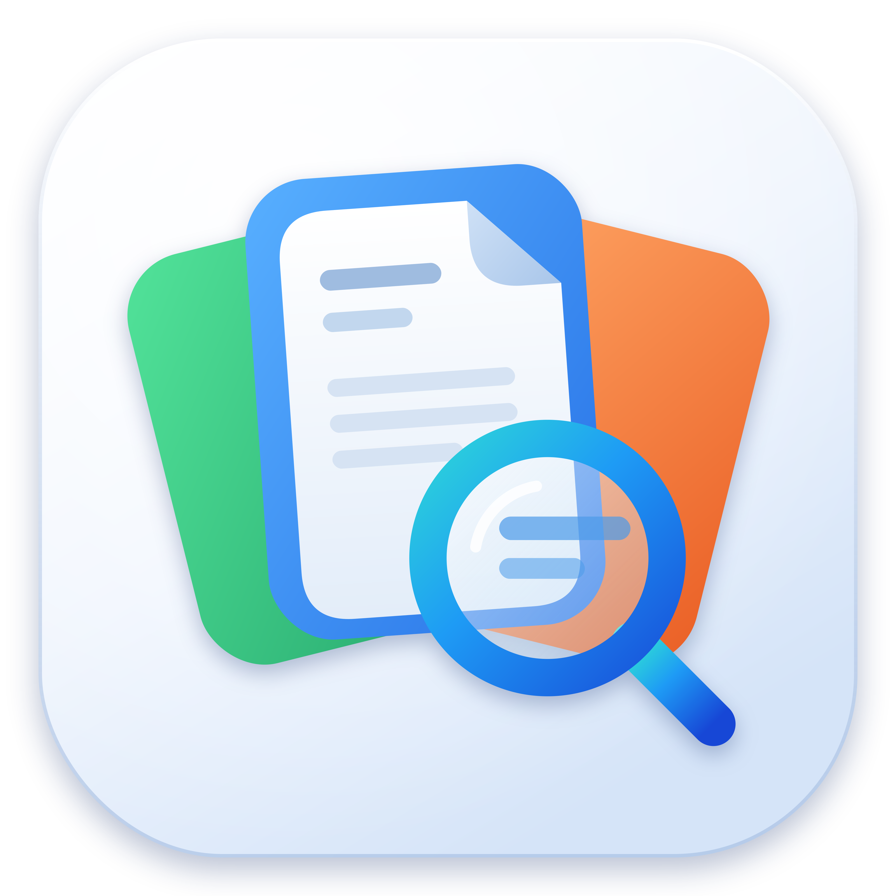

<div align="center">
  
  <h1>DocGlance</h1>
  <p>A fast, native Windows viewer for documents, spreadsheets, presentations, and text files.</p>
  <p>
    <a href="https://github.com/777abhishek/QuickView/releases">Download the latest release</a>
    ·
    <a href="https://github.com/777abhishek/QuickView/issues">Report a bug or request a feature</a>
  </p>
</div>

DocGlance is a 64-bit Windows desktop application built with **.NET 8**, **WinUI 3**, and native **Rust** rendering engines. It brings common document previews, PDF annotation, spreadsheet browsing, and offline translation together in one app.

## Features

- **Documents:** Open and read PDF and Word documents.
- **Presentations:** Browse PowerPoint slides.
- **Spreadsheets:** View `.xlsx`, `.xlsm`, `.xltx`, and `.xltm` workbooks, including sheets and cell contents. Legacy `.xls` files are not rendered in-app.
- **Text and code:** Preview plain text, Markdown, source code, and common configuration files.
- **Search and navigation:** Find document text, move between pages or slides, and inspect workbook sheets.
- **PDF annotations:** Add highlights and other text markup, freehand ink, notes, text boxes, signatures, and images.
- **Offline translation:** Translate selected text using downloaded translation models. An internet connection is needed to obtain models; translation runs locally after download.
- **Windows integration:** Open unsupported formats with their default application.

## Install

Download a published Windows build from [GitHub Releases](https://github.com/777abhishek/QuickView/releases). Releases may provide a packaged MSIX or an unpackaged executable; follow the installation notes attached to the specific release.

## Technology

| Area | Technology |
| --- | --- |
| Application | C#, .NET 8, WinUI 3 |
| Windows UI/runtime | Windows App SDK 2.4 |
| Spreadsheet drawing | Win2D |
| Native rendering and translation | Rust 2021 libraries: PdfCraft, WordCraft, GridCraft, DeckCraft, and the translation engine |
| Local data | Entity Framework Core with SQLite |
| MVVM utilities | CommunityToolkit.Mvvm |

The packaged app is configured to include the Windows App SDK runtime. Native Rust libraries are built as Windows x64 DLLs and called through the app's C ABI interop layer.

## Build from source

### Requirements

- Windows 10 version 2004 (build 19041) or later, x64.
- [.NET 8 SDK](https://dotnet.microsoft.com/download/dotnet/8.0).
- [Rust](https://www.rust-lang.org/tools/install), including the MSVC Windows target. The PDF rendering dependencies may require Rust 1.92 or later.
- Visual Studio C++ Build Tools with the MSVC toolchain and a Windows SDK.
- Git.

### Build and run

From a PowerShell terminal:

```powershell
git clone https://github.com/777abhishek/QuickView.git
Set-Location QuickView
.\build.ps1 -Unpackaged -Configuration Release
```

The build script builds the native Rust libraries, builds the app, and launches it. To create the default packaged MSIX build instead, run:

```powershell
.\build.ps1 -Configuration Release
```

Packaged builds use the package identity and signing configuration in `Package.appxmanifest` and `DocGlance.csproj`; local sideloading may require trusting an appropriate signing certificate. The unpackaged option is generally more convenient for local development.

### Run tests

```powershell
dotnet test .\DocGlance.Tests\DocGlance.Tests.csproj
```

## Contributing

Bug reports, feature requests, and pull requests are welcome. Please include reproduction steps for bugs and describe the behavior changed by a pull request. Build the app and run the relevant tests before submitting changes.

## License

The DocGlance project is licensed under the [MIT License](LICENSE). Third-party libraries, vendored code, fonts, and other assets may have separate license terms; review their accompanying notices before redistribution.
