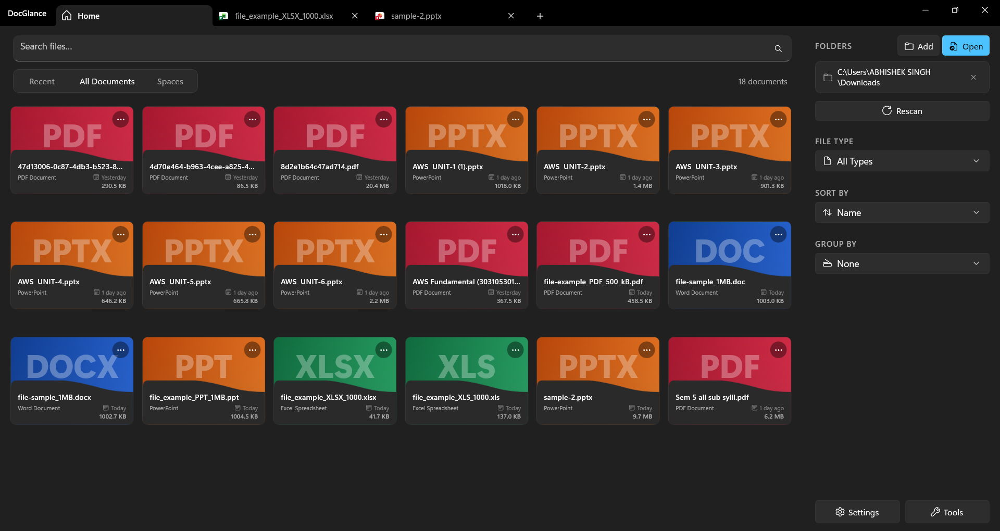
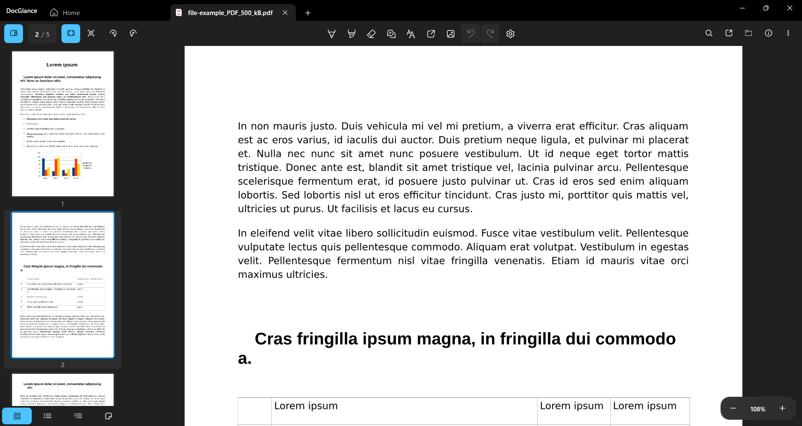
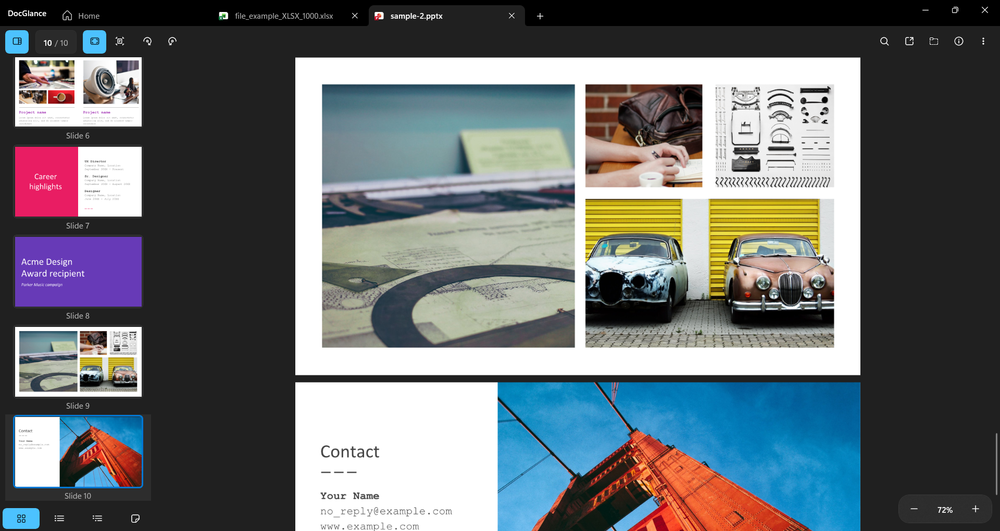
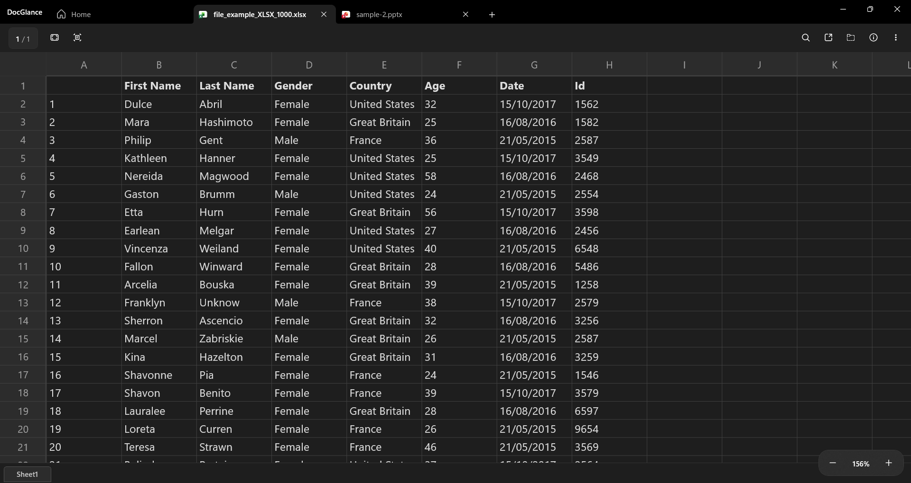
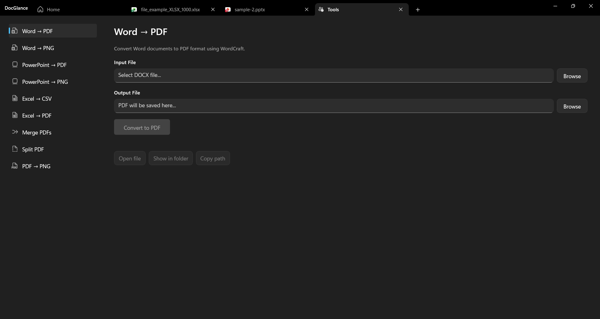
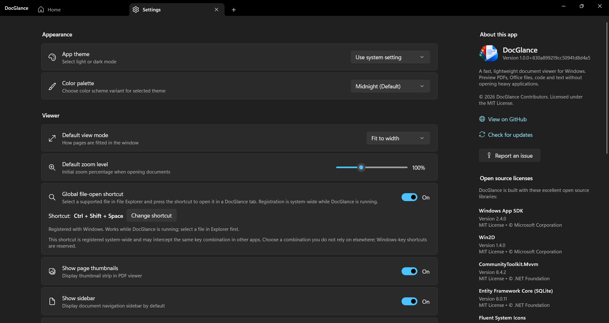

<div align="center">
  
  <h1>DocGlance</h1>
  <p>A fast, native Windows viewer for PDF, Word, Excel, PowerPoint, Markdown, and images.</p>
  <p>
    <a href="https://github.com/777abhishek/DocGlance/releases"></a>
    
    
    
  </p>
  <p>
    <a href="https://apps.microsoft.com/detail/9P6KFLR429Z6?hl=en-us&amp;gl=IN">
      
    </a>
  </p>
  <p>
    <a href="https://github.com/777abhishek/DocGlance/releases">⬇️ Download latest release</a>
    ·
    <a href="https://github.com/777abhishek/DocGlance/issues">🐛 Report a bug</a>
    ·
    <a href="https://github.com/777abhishek/DocGlance/issues">💡 Request a feature</a>
  </p>
</div>

---

## Screenshots

<div align="center">
  
  
  <br><br>
  
  
  <br><br>
  
  
</div>

---

## Features

- **PDF** — View, search, and annotate PDF files with highlights, ink, notes, and text boxes
- **Word (DOCX)** — Open `.docx` documents without Microsoft Office
- **PowerPoint (PPTX)** — Browse `.pptx`, `.pptm`, and `.ppsx` presentations
- **Excel (XLSX)** — View `.xlsx`, `.xlsm`, `.xltx`, and `.xltm` workbooks with full sheet navigation
- **Markdown & Text** — Preview `.md`, source code, and config files
- **Images** — View `.png`, `.jpg`, `.gif`, `.bmp`, `.webp`, and more
- **Tabbed interface** — Keep multiple documents open at once with instant switching
- **Offline translation** — Translate document text locally without an internet connection
- **HiDPI & 4K** — Crisp rendering on any display including 4K monitors
- **Search & navigation** — Find text, jump between pages/slides, navigate sheets
- **Fast startup** — No splash screen, documents open in seconds

---

## Install

### Option 1 — Microsoft Store (Recommended)

Install DocGlance from the [Microsoft Store](https://apps.microsoft.com/detail/9P6KFLR429Z6?hl=en-us&gl=IN).

Or install it from PowerShell or Command Prompt:

```powershell
winget install DocGlance
```

WinGet may show **Version Unknown** while retrieving a Microsoft Store app. This is Store-source metadata and does not mean the installation failed or that the app version is missing.

### Option 2 — GitHub Release (Direct download)

Download the setup executable from [GitHub Releases](https://github.com/777abhishek/DocGlance/releases).

> **Note:** The GitHub setup executable is a separate, unsigned distribution and may trigger a Windows SmartScreen warning. The Microsoft Store version is the recommended way to install DocGlance.

The `DocGlance.DocGlance` community WinGet package is a separate listing for the GitHub installer; it requires acceptance of its manifest pull request in [microsoft/winget-pkgs](https://github.com/microsoft/winget-pkgs). The command above installs the Store listing directly and does not depend on that pull request.

---

## Technology

| Area | Technology |
| --- | --- |
| Application | C#, .NET 8, WinUI 3 |
| Windows UI / runtime | Windows App SDK 2.4 |
| Spreadsheet drawing | Win2D |
| Native rendering engines | Rust 2021 — PdfCraft, WordCraft, GridCraft, DeckCraft |
| Offline translation | Rust — Firefox Translations engine (local, no cloud) |
| Local data | Entity Framework Core + SQLite |
| MVVM utilities | CommunityToolkit.Mvvm |

Native Rust libraries are compiled as Windows x64 DLLs and called through a C ABI P/Invoke interop layer.

---

## Build from Source

### Requirements

- Windows 10 version 2004 (build 19041) or later, x64
- [.NET 8 SDK](https://dotnet.microsoft.com/download/dotnet/8.0)
- [Rust](https://www.rust-lang.org/tools/install) with the `x86_64-pc-windows-msvc` target
- Visual Studio C++ Build Tools with the MSVC toolchain and Windows 11 SDK
- Git

### Quick build & run

```powershell
git clone https://github.com/777abhishek/DocGlance.git
cd DocGlance
.\build.ps1 -Unpackaged -Configuration Release
```

### Create a Microsoft Store submission package

```powershell
.\build-installer.ps1 -StoreUpload
```

Output: `installer\output\777abhishek.DocGlance_1.0.0_x64.msixupload`

Upload the `.msixupload` package to Partner Center for Store submission. This is an MSIX upload bundle, not an MSI installer; customers install the published app from the Microsoft Store. Microsoft signs the accepted Store package.

### Optional: Create a GitHub release installer

```powershell
.\build-installer.ps1 -GitHubRelease
```

This creates a separate direct-download EXE installer. It is not required for Store releases.

### Run tests

```powershell
dotnet test .\DocGlance.Tests\DocGlance.Tests.csproj
```

All 238 tests must pass before submitting a pull request.

---

## Contributing

Bug reports, feature requests, and pull requests are welcome. Please include reproduction steps for bugs and describe the behavior changed by a pull request. Build the app and run the full test suite before submitting changes.

## License

Licensed under the [MIT License](LICENSE). Third-party libraries, vendored code, fonts, and other assets may carry separate license terms — review their accompanying notices before redistribution.
