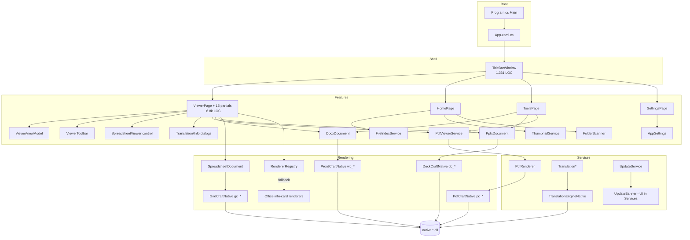

# 02 — Current Architecture (as built)

Derived from actual call-chain tracing; every claim cites the file that implements it. Companion to `01-repository-inventory.md` (finding IDs F1–F12 reused).

## 1. Layer model (as it actually behaves)

```
┌────────────────────────────────────────────────────────────────────┐
│ Program.cs (boot: DPI, single-instance redirect, IPC pipe client)  │
├────────────────────────────────────────────────────────────────────┤
│ App.xaml.cs  ── exception policy, renderer registration,           │
│                activation decode, file open, theme                  │
├────────────────────────────────────────────────────────────────────┤
│ UI/Shell/TitleBarWindow — tabs, tear-out, hotkey, session, acrylic │
│   └─ hosts pages (Frame-less TabView content switching):           │
│      ViewerPage (15 partials) · HomePage · ToolsPage · SettingsPage│
├──────────────┬───────────────┬────────────────┬───────────────────┤
│ Features/     │ Services/      │ Rendering/      │ Infrastructure/   │
│ Viewer pages  │ Documents(PDF) │ FFI bindings    │ Logging           │
│ Components    │ FileSystem     │ Doc lifecycles  │ NativeCallGate    │
│ Spreadsheet   │ Thumbnails     │ PdfViewer svc?  │ AppSettings       │
│ Home/Tools/   │ Translation    │ Office fallback │ Diagnostics       │
│ Settings      │ Updates        │ UI controls(!)  │                   │
├──────────────┴───────────────┴────────────────┴───────────────────┤
│ native/*.dll — pdfcraft(pc_) wordcraft(wc_) gridcraft(gc_)         │
│               deckcraft(dc_) translation(qv_)                      │
└────────────────────────────────────────────────────────────────────┘
```

No dependency-injection container exists. All cross-layer wiring is static:
`RendererRegistry.Register` (App.xaml.cs:233), `TitleBarWindow.Current` / `App.AllWindows` (App.xaml.cs:25), `NativeBitmap.Initialize` (App.xaml.cs:106), `AppSettings.SettingsChanged` events (ViewerPage.xaml.cs:101).

## 2. Workflow traces

### 2.1 Startup
1. `Program.Main` — PerMonitorV2 DPI before WinUI (`Program.cs:79`), single-instance check, redirect + pipe handover for second launches.
2. `App..ctor` — XAML exception handlers with deliberate no-handle policy (`App.xaml.cs:29-63`), `DiagnosticsService.LogEnvironment`, re-activation subscription.
3. `App.OnLaunched` — `NativeBitmap.Initialize(dispatcher)`; `RegisterRenderers()` (Office info-card fallbacks only — comment at `App.xaml.cs:227-228` admits the real path is the native wrappers); construct `TitleBarWindow`; `ActivationIpc.StartServer`; unpackaged `RegistrationHelper.EnsureRegisteredAsync()`; decode activation args / command line → open files; else schedule `RestoreSession` at low dispatcher priority.

### 2.2 Opening a file (all entry paths converge)
- Entry paths: Explorer activation, redirect args, IPC pipe (`OpenExternalFiles`), command line, tab drag-drop (`TitleBarWindow.RootGrid_Drop`), file picker (`OpenFilePicker`), Home card click, Quick-Look hotkey (`HandleGlobalFileOpenHotkey` → selected Explorer file).
- All end in `DocumentItem.FromFileInfo` → `TitleBarWindow.OpenDocument(doc)` (`UI/Shell/TitleBarWindow.xaml.cs:473`) which creates a tab hosting `ViewerPage` and calls `LoadDocument(doc)`.
- Validation happens only on the App activation path (`FileSizeValidator.IsFileValidAndSafe`, `App.xaml.cs:319`) — not on drag-drop/picker paths (minor inconsistency, noted; not a bug hunt).

### 2.3 Format identification & viewer selection — **the load balancer is a hardcoded if/else**
`ViewerPage.Pdf.cs:120-143` (`LoadDocumentCoreAsync`):

| Extension(s) | Handler | Downstream |
|---|---|---|
| `.pdf` | `LoadPdfAsync` | `IPdfViewerService.LoadDocumentAsync` (password retry loop) → `PdfRenderer` → `PdfCraftNative` → `pc_*` |
| `.docx/.doc` | `LoadDocxAsync` | `DocxDocument` → `wc_*` |
| `.pptx/.ppt/.pptm/.ppsx` | `LoadPptxAsync` | `PptxDocument` → `dc_*`; slides rendered on demand in viewport partial |
| `.xlsx/.xlsm/.xltx/.xltm` | `LoadXlsxAsync` | `SpreadsheetDocument` → `gc_*`; content via `SpreadsheetViewer` control |
| text-ish (`IsTextFile`) | `LoadTextFileAsync` | `TextFileReader.ReadCapped` → `PlainTextBlock` + `SearchHighlighter` |
| anything else | `RendererRegistry.GetRenderer(ext)` | 3 registered `IFileRenderer`s → info cards; else `ShowInfoCard` |

`RendererRegistry` is therefore a **fallback-only** mechanism (F4); the registry never participates in the five real formats.

### 2.4 Rendering pipelines (per format)
- **PDF**: `PdfViewerService` owns lifecycle + page-image caches + prefetch (`Services/Documents/PdfViewerService.cs:180-268`); `PdfDocumentState` owns the native handle; `ViewerPage.Viewport.cs` drives viewport → `RenderPagesAsync`; pixels via `NativeBitmap.FromRgba` (BGRA conversion on UI dispatcher); `RenderBudget` caps cache memory. Text layer: `PdfTextService` builds `PdfPageTextMap` for selection; search via `pc_search_text`.
- **DOCX/PPTX**: viewport-driven page/slide image rendering inside `ViewerPage.Pdf.cs` + `ViewerPage.Viewport.cs` (`RenderDocxViewportAsync`, `RenderPptxViewportAsync`), with per-document tile caches (`ClearDocxCache`, `ClearPptxCache`) and text maps (`_pptxTextMaps`) as ViewerPage fields.
- **XLSX**: `SpreadsheetDocument` provides `SheetData`; the **`SpreadsheetViewer` Win2D control** owns grid rendering, virtualization, cell selection, zoom, and search-highlight painting — the only format whose rendering is genuinely isolated behind a control API (this is the pattern the other formats lack).
- **Text/code**: single `TextBlock`-based flow with `SearchHighlighter`.

### 2.5 Navigation/toolbar/zoom/search/copy
- Toolbar: `ViewerToolbar` control raises events (`PdfToolSelected`, `FindRequested`, `FitWidthRequested`…); handled in `ViewerPage.Toolbar.cs`; toolbar also has imperative setters (`UpdatePageInfo`, `SetMarkupToolActive`, `SidebarButtonVisibility`) — event + imperative hybrid, tightly coupled to ViewerPage.
- Zoom/fit: `ViewerPage.Zoom.cs` (315) with `FitMode` + `SetFitMode/SetZoom/ReapplyFitMode`; the same *concept* is re-implemented inside `SpreadsheetViewer` (`ZoomChanged`, `ManualZoomRequested` events) — two zoom engines bridged by event forwarding (`ViewerPage.xaml.cs:81-89`).
- Search: `ViewerPage.Search.cs` (478) branches per format (`pc_/wc_/dc_/gc_search_text`) and per-viewer highlighting (PDF overlay vs text `SearchHighlighter` vs spreadsheet `SetSearchMatches`).
- Copy: three implementations — PDF selection rects → text (`ViewerPage.PdfTextSelection.cs`), Office selection (`ViewerPage.OfficeTextSelection.cs`, 515), spreadsheet cell copy (inside `SpreadsheetViewer`).
- Selection state is per-format ViewerPage fields (`_selectedText`, `_officeSelectionAnchor/Focus`, PDF selection in `PdfTextSelection` partial) — no shared selection contract.

### 2.6 Closing/lifecycle
Tab close → `TitleBarWindow.CloseTabAsync` → `ViewerPage.CancelLoad()` (`ViewerPage.xaml.cs:207-253`): cancels three CTSs (`_cts`, `_searchCts`, `_spreadsheetSearchCts`), flushes pending PDF annotations (deferred save), invokes renderer cleanup, then disposes each format's document object **by name** (`_spreadsheetDocument?.Dispose()`, `_pptxDocument?.Dispose()`, `_docxDocument?.Dispose()`, `_pdfService` re-created). This method is a concrete catalogue of F1: every format's teardown is hand-written in the shared page.

### 2.7 Native communication
- Boundary style: flat C ABI per crate; prefix-per-engine (`pc_/wc_/gc_/dc_`), `qv_` for translation (F11).
- Ownership: Rust allocates documents/images/buffers; C# frees via matching `*_free_*` (documented in `WordCraftNative.cs:4-9` and peers). Handles are wrapped in `readonly struct` opaque types.
- Threading: `Infrastructure/Concurrency/NativeCallGate` serializes calls vs `Dispose` (docs/reliability audit D1 describes the historic PdfDocumentState gap; current wrappers route through gates).
- Errors: `catch_unwind` on the Rust side returns sentinel/null; C# wrappers throw `InvalidOperationException`-style exceptions with engine context; `Logger` at boundary.
- Pixel buffers: Rust returns `{pixels ptr, w, h, len}` structs → C# copies on dispatcher → `WriteableBitmap` → freed immediately.

## 3. Component diagram (actual)



## 4. Dependency diagram (allowed today — note the back-edges)

```mermaid
flowchart LR
    Program --> App --> Shell[UI/Shell]
    Shell --> Pages[Features/*]
    Pages --> Services
    Pages --> Rendering
    Services --> Rendering   %% PdfViewerService → PdfRenderer
    Services --> UI          %% UpdateBanner used by TitleBarWindow; TranslationDialogs in Features use Services
    Rendering --> UI         %% PptxViewerControl, ViewerInfoCard
    Rendering --> Features?  %% none (clean)
    Pages --> Infrastructure
    Rendering --> Infrastructure
    Services --> Infrastructure
    Core[Core models] ← used by all
```

Observed rule violations of a clean "UI → Features → Services → Rendering → native" flow:
- `Rendering` → `UI` (`PptxViewerControl` is a control; `Office/*Renderer` produce `UIElement`s; `ViewerInfoCard` referenced from Rendering).
- `Services` → XAML (`UpdateBanner.xaml`; `IPdfViewerService` returns `WriteableBitmap`).
- `Features/Tools` bypasses Services and calls document classes in `Rendering` directly (acceptable today — there is no Tools service — but it means format engines have two consumer shapes).

## 5. Where responsibility actually lives (summary matrix)

| Concern | Owner today | Assessment |
|---|---|---|
| Format selection | `ViewerPage.Pdf.cs` if/else | Hidden in the largest partial (F2) |
| Document lifecycle | ViewerPage per-format fields + each Document class | Duplicated teardown (2.6) |
| Zoom | ViewerPage.Zoom + SpreadsheetViewer internal | Two engines (F1) |
| Search | ViewerPage.Search branching per engine | UI + orchestration + plumbing in one partial |
| Copy/selection | 3 independent implementations | No shared contract |
| Toolbar | ViewerToolbar events + imperative setters | Coupled to ViewerPage specifics |
| Thumbnails sidebar | Inline in ViewerPage (`Thumbnails`, `ThumbnailList`) + `PageThumbnailSidebar` control unused | F9 |
| PDF orchestration | `Services/Documents/PdfViewerService` (the only such service) | Other formats have no equivalent service — their orchestration lives in ViewerPage partials |
| File index/home | `Services/FileSystem/*` + HomePage | Reasonably separated |
| Settings | `AppSettings` over `SettingsStore`; Translation duplicates the mechanism | F10 |
| Interop | `*Native.cs` in Rendering (+ TranslationEngineNative in Services) | Scattered by crate, style drift (F11) |

## 6. What is already good (keep)

1. **Per-format Rust engines with a uniform ABI style** — `*_open_*`, `*_render_*`, `*_search_text`, `*_free_*` are recognizably parallel across crates; memory contracts documented on both sides.
2. **`SpreadsheetViewer` control boundary** — proves a format can own its UI behind an API (events in, commands out) while ViewerPage only coordinates.
3. **`NativeCallGate` + `SafeFireAndForget` + queued Logger** — real, tested infrastructure pieces (`DocGlance.Tests/Infrastructure/*`).
4. **Folder taxonomy mostly right** — Common/Core/Infrastructure/Services/UI/Features would be recognizable to any WinUI developer; the pathology is concentration (ViewerPage, TitleBarWindow), not folder chaos.
5. **Tests target the testable seams that exist** — formatters, validators, models, gate, logger, PDF service, translation logic.
