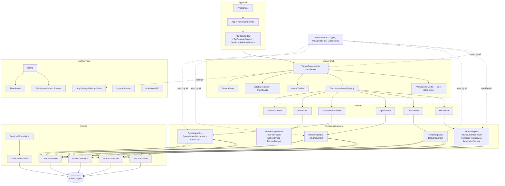

# 03 — Target Architecture

Design goals derived from the audit: dissolve the ViewerPage god class (F1–F3), retire the dead renderer pipeline (F4), make every format live behind one boundary, and stop UI/Services/Rendering layering violations (F6, F8) — **without** a rewrite, without new csproj projects, and without forcing formats into identical shapes.

## 1. Architectural principles

1. **One format, one module.** Everything format-specific — FFI bindings, document class, viewer control — lives in one folder per format under `Features/Viewer/Viewers/<Format>/` (UI) and `Rendering/<Format>/` (engine). Nobody outside those folders says "pdfcraft" or "docx".
2. **The SpreadsheetViewer precedent is the pattern.** `Features/Viewer/Spreadsheet/SpreadsheetViewer` already proves the target shape: a control that owns rendering/selection/zoom internals and exposes events + methods. Every format gets that; `ViewerPage` becomes a thin coordinator.
3. **Capability interfaces, not a god interface.** A minimal `IDocumentViewer` contract for lifecycle; optional capabilities (`ISupportsSearch`, `ISupportsZoom`, `ISupportsTextSelection`, `ISupportsAnnotations`, `ISupportsOutline`) that the shell discovers by casting. A viewer implements only what it truly supports — no meaningless methods.
4. **Single state owner.** `ViewerViewModel` (renamed responsibilities, not the name) becomes the *only* holder of page/zoom/rotation/sidebar state. Viewer controls receive state changes and raise intents — the `_page/_zoom/_total` fields and `SyncToViewModel()` dance (F3) disappear.
5. **Interop in one place.** All FFI bindings under `Interop/<Engine>/`; bindings are `internal`, never leak past the engine class. Memory contracts (Rust allocates → C# frees) documented once per binding file, as today.
6. **Folders-as-modules, one app project.** No new class libraries. WinUI XAML compilation, MSIX packaging, and the existing test-project linkage all stay simple; module boundaries are enforced by namespace rules (doc 08) instead of assembly references. Splitting into csproj libraries is justified only if a second front-end (e.g. the Android/Kotlin exploration in `docs/android-kotlin-integration.md`) becomes real.
7. **Keep what works.** Rust crates and their C ABI stay **completely untouched** — export prefixes `pc_/wc_/gc_/dc_/qv_` all stay as-is (AF-09). `NativeCallGate`, Logger, settings stores, thumbnail/file-index services keep their design.

## 2. Modules and responsibilities

| Module (folder) | Responsibility | Contains |
|---|---|---|
| `Features/Viewer/` (shell) | Tab document host: toolbar wiring, sidebar, status, loading/error/unsupported states, keyboard routing, zoom/fit coordination, search panel hosting, translation dialog launching | `ViewerPage`, `ViewerViewModel`, `DocumentViewerRegistry` (selection), `Components/` (toolbar, dialogs) |
| `Features/Viewer/Viewers/Pdf` | PDF viewer control: viewport rendering, page navigation, text selection, annotations UI, search plumbing | wraps `Rendering/Pdf` engine |
| `Features/Viewer/Viewers/Docx` | Word viewer control: paginated viewport, selection, outline | wraps `Rendering/Docx` |
| `Features/Viewer/Viewers/Pptx` | Slide viewer control | absorbs `Rendering/Presentation/PptxViewerControl` |
| `Features/Viewer/Viewers/Spreadsheet` | existing control, moved as-is | wraps `Rendering/Xlsx` |
| `Features/Viewer/Viewers/Text` | plain-text/markdown/code viewer | absorbs `ViewerPage.Text.cs` + `SearchHighlighter` |
| `Features/Viewer/Viewers/Fallback` | info card for unsupported types | absorbs `ViewerInfoCard` + `ShowInfoCard` |
| `Rendering/<Format>` (Pdf, Docx, Xlsx, Pptx) | engine per format: document class (native handle owner), render/text/search services — all UI-free | e.g. `PdfDocument`, `PdfRenderer`, `PdfTextService`, `PdfAnnotationService` |
| `Rendering/Shared` | `NativeBitmap`, `RenderBudget` | |
| `Interop/` | FFI bindings only: `PdfCraftNative`, `WordCraftNative`, `GridCraftNative`, `DeckCraftNative`, `TranslationNative` | no logic, no UI |
| `Services/` | app-wide services unchanged in kind: activation, file index/scanner, thumbnails, storage, translation, updates (UI bits move out), `PdfViewerService` moves into `Rendering/Pdf` as the format's orchestration | |
| `Core/` | format-neutral models only (`DocumentItem`, `OutlineItem`, …) + shared enums/constants; `Pdf*` models move to `Rendering/Pdf` | |
| `Common/` | pure helpers unchanged | |
| `Infrastructure/` | logging, native gate, settings facade, diagnostics unchanged | |
| `UI/` | shell window, shared controls, styles, icons | `TitleBarWindow` slimmed (doc 05) |

## 3. Viewer registration and selection

`DocumentViewerRegistry` (new, ~60 LOC, static like today's `RendererRegistry` — DI container explicitly rejected as overkill for this codebase) maps *extension → viewer factory*:

```csharp
public interface IDocumentViewerFactory
{
    string[] SupportedExtensions { get; }
    IDocumentViewer Create(ViewerViewModel viewModel);
}

public interface IDocumentViewer
{
    FrameworkElement Control { get; }
    Task LoadAsync(DocumentItem document, CancellationToken ct);
    Task CleanupAsync();   // flush, dispose native documents — replaces CancelLoad's by-name cascade
}
```

Registered once at startup in priority order: `PdfViewerFactory`, `DocxViewerFactory`, `PptxViewerFactory`, `SpreadsheetViewerFactory`, `TextViewerFactory`, `FallbackViewerFactory` (always matches). Selection is *registry lookup*, replacing the if/else in `ViewerPage.Pdf.cs:120-143`. This deliberately **replaces** `IFileRenderer`/`RendererRegistry`/`Rendering/Office/*` (F4) — same mechanism, but the contract returns a live viewer that owns lifecycle, not a one-shot `UIElement` that can't clean up native state (the exact reason `PptxRenderer` returns `null` today).

The existing `IFileRenderer` interface, `RendererRegistry`, `Core/Interfaces/IFileRenderer.cs`, `Office/*Renderer` are deleted in the same phase that introduces the registry — no parallel mechanisms.

## 4. Capability contracts (shell ↔ viewer)

Defined in `Features/Viewer/Contracts/` (final location — the contracts reference `FrameworkElement`, so WinUI-free Core cannot host them; AF-04), each ≤ 30 LOC:

| Contract | Members | Implementers |
|---|---|---|
| `ISupportsZoom` | `SetZoom(double)`, `SetFitMode(FitMode)`, `FitMode CurrentFitMode`, event `ZoomChanged` | Pdf, Docx, Pptx, Spreadsheet (Text: no zoom) |
| `ISupportsSearch` | `Task<SearchResult[]> SearchAsync(string, CancellationToken)`, `Highlight(SearchResult)`, `ClearHighlight()` | all five |
| `ISupportsTextSelection` | `event SelectionChanged`, `Task<string?> GetSelectedTextAsync()`, `CopySelectionAsync()` | Pdf, Docx, Pptx, Spreadsheet, Text |
| `ISupportsOutline` | `IReadOnlyList<OutlineItem> Outline`, `NavigateTo(OutlineItem)` | Pdf, Docx, Pptx |
| `ISupportsAnnotations` | toolbar tool state, `FlushPendingAsync()` | Pdf only |
| `ISupportsThumbnails` | thumbnail source | Pdf, Docx, Pptx |

ViewerPage code becomes: `if (viewer is ISupportsSearch s) { bind search panel to s }`. No format knowledge, no null hacks. Search *UI* (panel, next/prev) is shared; search *execution* stays in each engine (already true — each crate has `*_search_text`).

## 5. Document lifecycle

```
OpenDocument(doc)
  → ViewerPage: oldViewer?.CleanupAsync()          // single generic call, replaces CancelLoad cascade
  → DocumentViewerRegistry.Create(...)
  → viewer.LoadAsync(doc, ct)                      // engine opens native doc (or shows info card)
  → state (zoom/fit defaults from AppSettings) pushed via ISupportsZoom
Tab close / navigate-away
  → viewer.CleanupAsync()                          // each viewer disposes exactly its own native handles
  → cancellation of in-flight loads via shared ct
```

Each engine class remains the *sole* owner of its native handle (unchanged from today's `DocxDocument`/`PptxDocument`/`SpreadsheetDocument`/`PdfViewerService` design); the change is that teardown is reached through one interface instead of ViewerPage knowing each field name (`ViewerPage.xaml.cs:207-253`).

## 6. Native backend boundaries

- C# sees engines (`PdfDocument`-style classes), never `PcDocument*` or export names. `Interop/*` classes are `internal` and referenced only by their engine.
- Rust crates unchanged: one crate per format + translation; `catch_unwind` wrappers; prefix-per-engine ABI (`pc_/wc_/gc_/dc_/qv_` — all retained, AF-09).
- Ownership/lifetime rules already documented per binding file become a single `Interop/README.md` contract table (Rust allocates → C# must call matching free; all calls through `NativeCallGate` or engine-level lock; dispose cancels + drains).
- Errors: Rust returns status codes/empty handles; engines translate to exceptions with engine context; `IDocumentViewer.LoadAsync` maps to error-card state. No new wrappers — the existing five are exactly one per engine (F6 fix is *location*, not structure).

## 7. Proposed architecture



Dependency direction (enforced rules in doc 08): `Program/App → Shell → ViewerPage → Viewers → Rendering engines → Interop → DLL`, with `Infrastructure` and `Core` referenced by everything above them; **no** upward edges, **no** Rendering→UI, **no** Services→XAML.

## 8. Shared vs format-specific capability matrix

| Capability | Shared (shell/UI) | Contract | Format-specific implementation |
|---|---|---|---|
| File open/activation | `App`+`ActivationService` | — | — |
| Format selection | `DocumentViewerRegistry` | `IDocumentViewerFactory` | each factory lists extensions |
| Toolbar | `ViewerToolbar` (shared visual) | capability checks | PDF markup tools visible only when `ISupportsAnnotations` |
| Zoom/fit | toolbar + `ViewerViewModel` state | `ISupportsZoom` | per-viewer zoom math (already diverges: spreadsheet grid vs page images) |
| Navigation | page indicator, outline pane | `ISupportsOutline` | page/slide/sheet units stay native to each viewer; **no** unified "AbstractPage" model |
| Search | search panel + next/prev UI | `ISupportsSearch` | each engine's `*_search_text` + its highlighter (PDF overlay, text runs, grid cells) |
| Copy | toolbar/context command | `ISupportsTextSelection` | PDF rects→text vs cell ranges vs plain text — three implementations, one command |
| Thumbnails | sidebar host | `ISupportsThumbnails` | PDF/DOCX/PPTX render their own |
| Annotations | toolbar tools + save prompting | `ISupportsAnnotations` | PDF only |
| Translation | dialog launch + selection source | uses `ISupportsTextSelection` | translation engine untouched |
| Unsupported formats | `FallbackViewer` info card | — | — |
| Lifecycle | ViewerPage orchestration | `IDocumentViewer.CleanupAsync` | each engine frees its handles |

## 9. Service ownership after the move

| Service | Today | Target |
|---|---|---|
| `PdfViewerService`+`IPdfViewerService`+`PdfLoadResult` | `Services/Documents/` | `Rendering/Pdf/` (it is PDF orchestration, not an app service; interface kept — it has a genuine second consumer shape: Tools page + viewer) |
| `UpdateBanner.xaml` | `Services/Updates/` | `UI/Controls/` |
| `AppRegistration` icon-name mapping | `Services/Registration/` | stays as-is, icon map included (AF-11 — unpackaged-only detail, single consumer) |
| `TitleBarWindow` session/hotkey/tab internals | inline 1,331 LOC | extracted: `Services/Session/SessionService`, `Services/Input/QuickLookHotkeyService` (reuse `GlobalHotkeyRegistration`), tab logic stays in window |
| Activation decoding/IPC-from-App | `App.xaml.cs` | `Services/Activation/ActivationService` (App keeps wiring only) |
| FileWatcherService, BrowserPage, CodeRenderer, PageThumbnailSidebar, Office/*Renderer, RendererRegistry, IFileRenderer | scattered | deleted (doc 09) after verification |

## 10. What this design deliberately does NOT do

- No DI container, no MediatR, no MVVM framework beyond CommunityToolkit, no `Manager`/`Factory` classes beyond the one registry, no new csproj libraries (principle 6).
- No unified document data model across formats (a PDF page and a worksheet stay different things).
- No Rust refactor, no C++ (none exists — the task brief mentioned C++; the repo has none. Rust is the only native language).
- No change to settings, logging, thumbnail, or indexing designs — they pass the audit.
